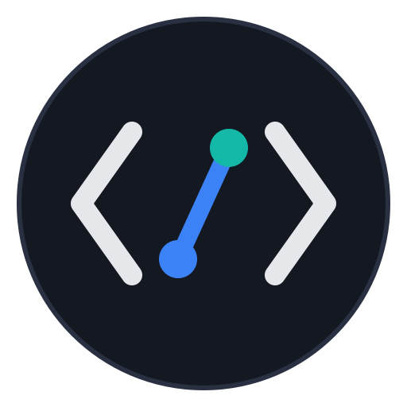

<p align="left">
  
</p>

# TexReq

A fast, lightweight native desktop API client built with **Rust** and **GPUI-Kit**.

Designed around a flat dark interface with crisp `1px` structural panel cuts, zero gradients, and GPU-accelerated rendering for testing **HTTP**, **GraphQL**, **WebSockets**, and **Server-Sent Events (SSE)**.

## Features

- **HTTP / HTTPS Client**: `GET`, `POST`, `PUT`, `PATCH`, `DELETE`, `HEAD`, and `OPTIONS` backed by `reqwest` + `rustls`.
- **Body Editors**: JSON (with syntax highlighting and one-click formatting), GraphQL (query + variables), URL-encoded forms, multipart file uploads, raw text, and binary files.
- **Authentication**: Bearer Token, Basic Auth, and API Key (header or query string).
- **WebSockets & SSE**: Connect to `ws://` / `wss://` endpoints and Server-Sent Event streams with saved message templates and a searchable real-time frame log.
- **Environments & Response Chaining**: Manage multiple environments (`{{variable}}` interpolation across URLs, params, headers, auth, and body), import `.env` files, and capture response JSON paths automatically into environment variables.
- **Code Snippets & TLS Inspector**: Generate ready-to-run snippets (`cURL`, JavaScript `fetch`, Rust `reqwest`, Python `requests`) and inspect resolved URLs, TLS info, and TTFB timings.
- **Settings, Git Workspace & Auto-Updater**:
  - Toggle auto-save, JSON auto-formatting, global SSL/TLS verification, default redirects, timeout, and proxy settings.
  - Choose any local workspace directory for storing `collections.json` and `environments.toml` with built-in Git support (`init`, `commit`, `pull`, `push`).
  - Built-in update checker (checks GitHub Releases on launch and on demand under **Settings -> Updates**).

## Installation

Pre-built installers and binaries are published on [GitHub Releases](https://github.com/Textic/TexReq/releases):

- **Windows**: Run `texreq-<version>-windows-x86_64-setup.exe` for the Start Menu / Add & Remove Programs wizard installer (or download the portable `.exe` / `.zip`).
- **macOS**: Open `texreq-<version>-macos-arm64.dmg` (Apple Silicon) or `texreq-<version>-macos-x86_64.dmg` (Intel) and drag `TexReq.app` to `Applications`.
- **Linux**:
  - **Debian / Ubuntu / Mint**: `sudo apt install ./texreq-<version>-linux-x86_64.deb`
  - **Other distros**: Extract `texreq-<version>-linux-x86_64.tar.gz` and run `./install.sh` (installs to `~/.local/bin` and `~/.local/share/applications`).

## Building & Running

### Prerequisites

- Rust toolchain (`cargo`):
  - **Windows**: Visual Studio C++ Build Tools (MSVC).
  - **Linux (Ubuntu/Debian)**: `pkg-config cmake clang libssl-dev libfontconfig1-dev libfreetype-dev libxkbcommon-dev libxkbcommon-x11-dev libwayland-dev libxcb1-dev libxcb-render0-dev libxcb-shape0-dev libxcb-xfixes0-dev libx11-dev libvulkan-dev`.
  - **macOS**: Xcode Command Line Tools.
- Optional: `git` CLI in `PATH` for integrated Git repository management inside Settings.

### Run in Release Mode (Recommended for full frame rate)

```bash
cargo run --release
```

### Run Tests & Debug Build

```bash
cargo test
cargo build
```

## Releases & Branch Workflow

- `dev` branch: active development; pushes and pull requests to `main` automatically run tests and verify release builds across Windows, Linux, and macOS via GitHub Actions ([CI](.github/workflows/ci.yml)).
- `main` branch: merging a PR or pushing to `main` automatically builds and publishes a tagged GitHub Release (`v<major>.<minor>.<patch>`) with native installers (`-setup.exe`, `.dmg`, `.deb`), portable archives (`.exe`/`.zip`/`.tar.gz`), and SHA-256 checksums ([Release](.github/workflows/release.yml)).

## Project Structure

```text
src/
  main.rs          # Window configuration, global shortcuts, theme bootstrap
  theme.rs         # Flat dark color tokens, crisp resize handles, radii
  models/          # Request, response, collection, environment, WS, and settings data types
  net/             # Async HTTP, SSE, WebSocket clients, variable interpolator, snippets
  storage/         # Local JSON/TOML persistence and Git CLI wrapper
  ui/              # GPUI-Kit workspace, sidebar, request/response panes, drawers, KV tables
build.rs           # Sets 8 MB stack size on Windows MSVC targets
```

## License

MIT
